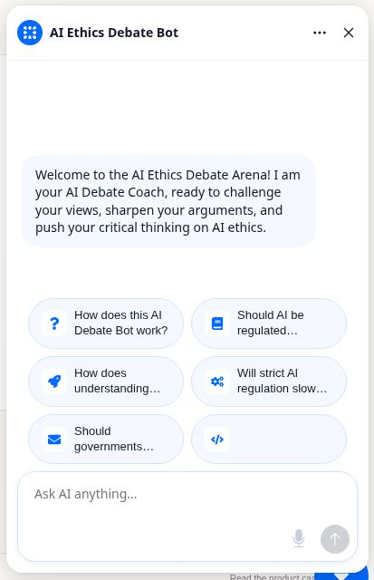

# AI Ethics Debate Coach

An Odin AI chatbot that helps learners examine AI ethics and governance through questions, counterarguments and reflection.

### [▶ Try the live demo](https://yifeng-lab.github.io/ai-ethics-debate-coach/debate.html)

**Open the page, then click the blue chat button in the bottom-right corner.**

*Click the preview to open the live experience.*

## My role

- **Conversation design:** Defined the agent's role and rules, with a four-to-five-round target ending in reflection.
- **Knowledge and prompts:** Selected AI governance and literacy materials; refined prompts and tone for supportive, challenging dialogue.
- **User experience:** Designed a learning activity and embedded the chatbot in a web page.

## Project materials

[Product case](https://yifeng-lab.github.io/ai-ethics-debate-coach/) · [Prompt](PROMPT.md) · [Design & iteration](DESIGN.md) · [Evaluation plan](EVALUATION.md) · [Lesson plan](https://docs.google.com/document/d/1NeaM5EjIYPxuGoMmmTevyBwGYawtsf-4zVGdTja0Mg4/edit?usp=sharing)

Chat is powered by Odin AI. This repository contains the website and design documents. Prompt iteration does not involve model-weight training; the evaluation plan has not yet been executed.
